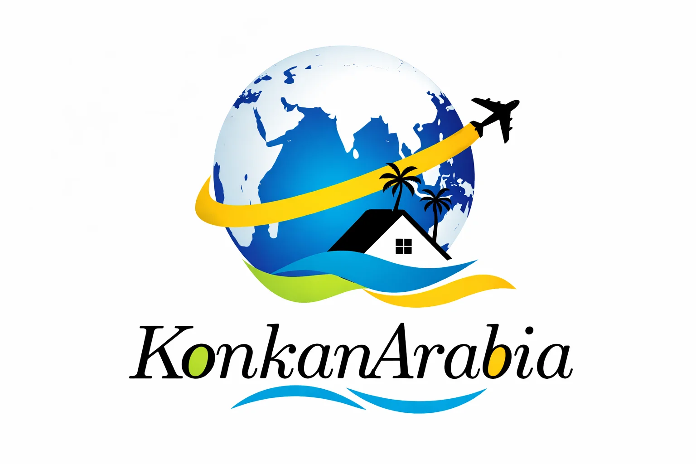

# KonkanArabia — Luxury Tours, Travel & Hospitality

The official production web platform for **KonkanArabia Hospitality & Holiday Group (OPC) Private Limited** — delivering curated domestic and international tour packages, Goa tourist taxi rentals, PedneCar fleet operations, bespoke Dubai itineraries, and hospitality franchising across the Konkan coast and Arabian Gulf.



## Stack

| Concern | Choice |
| :--- | :--- |
| **Framework** | Next.js 16 (App Router, Turbopack, Server Actions) |
| **Runtime & Language** | React 19, TypeScript (strict), Node.js >=20 |
| **Styling & Design** | Tailwind CSS v3.4, layered shadows (`.shadow-soft`, `.shadow-lift`), fluid layout |
| **Motion** | Framer Motion 12 (custom springs, easing curves, `layoutId` pill indicators, staggered entrances) |
| **UI Primitives** | Radix UI, Lucide React, Embla Carousel, TipTap Rich Text |
| **Database & ODM** | MongoDB, Mongoose 9 |
| **AI & Automation** | Google Gemini 2.0 API (Aura travel concierge, AI spam quarantine, itinerary generation) |
| **Communications** | Resend (transactional email, booking enquiries, franchise leads) |
| **Media & Storage** | Cloudinary (responsive tourism imagery) |
| **Testing** | Vitest 3, TypeScript strict typecheck (`tsc --noEmit`), ESLint 9 |
| **Deployment** | Netlify (`@netlify/plugin-nextjs`), GitHub Actions CI |

## Getting Started

### Prerequisites

- Node.js >= 20 (`.nvmrc` targets Node 22)
- MongoDB instance (local or MongoDB Atlas)
- Optional API keys: Google Gemini AI, Resend, Cloudinary (see `.env.example`)

### Installation

```bash
# Clone the repository
git clone https://github.com/konkanarabia/website.git
cd website

# Install dependencies
npm install

# Setup environment variables
cp .env.example .env
```

### Development Server

```bash
npm run dev
```

Open [http://localhost:3000](http://localhost:3000) in your browser.

## Scripts

| Script | Command | Purpose |
| :--- | :--- | :--- |
| `npm run dev` | `next dev` | Start development server with Turbopack & Fast Refresh |
| `npm run build` | `next build` | Production build and static page prerendering |
| `npm run start` | `next start` | Launch production server |
| `npm run typecheck` | `tsc --noEmit` | Strict TypeScript compilation check |
| `npm run lint` | `eslint .` | Lint source code with ESLint 9 |
| `npm test` | `vitest run` | Execute test suite (88 unit and integration tests) |

## Project Structure

```
tours-travel-website/
├─ .agents/
│  └─ skills/              Agent skills for frontend & motion design workflows
├─ .github/
│  └─ workflows/ci.yml     Automated CI pipeline (lint, typecheck, tests, build, audit)
├─ app/
│  ├─ (routes)/            Public pages (about, destinations, pednecar, vehicles, etc.)
│  ├─ actions/             Next.js Server Actions (auth, destinations, enquiries, spam)
│  ├─ admin/               Protected management dashboard with session tokens
│  ├─ api/                 REST endpoints (contact, enquiry, franchise-enquiry)
│  ├─ components/          Motion sections, hero, header, marquee, skills showcase
│  ├─ globals.css          Design tokens, CSS layered shadows, ticker animations
│  ├─ layout.tsx           Root layout with I18nProvider, headers, and metadata
│  ├─ page.tsx             Home page composing interactive sections
│  ├─ robots.ts            Search engine crawler rules
│  └─ sitemap.ts           Dynamic XML sitemap generator
├─ components/             Reusable UI primitives (Radix wrappers, badges, buttons)
├─ docs/                   Technical specifications and architectural documentation
├─ hooks/                  Custom React hooks (useCurrency, useLocale, useTheme)
├─ lib/
│  ├─ ai-spam-agent.ts     Gemini-powered spam assessment agent
│  ├─ antispam.ts          Deterministic heuristic spam filters and quarantine pipeline
│  ├─ auth.ts              Constant-time password comparison and session verification
│  ├─ currency-conversion  Multi-currency calculation and exchange rates
│  ├─ models/              Mongoose schemas (Destination, Enquiry, Vehicle, Session)
│  ├─ mongodb.ts           Cached connection manager for MongoDB
│  ├─ motion.ts            Unified motion language (ease, spring, stagger, maskWord)
│  └─ rate-limit.ts        IP-based rate limiting for forms and authentication
├─ public/                 Branding, certificates, destination photos, vehicle assets
├─ tests/                  Vitest test suites for auth, spam agent, sanitize, sitemaps
├─ next.config.mjs         Content Security Policy, caching headers, redirects
└─ proxy.ts                Edge proxy middleware guarding admin routes and rate limits
```

## Key Features & Innovations

### 1. Unified Motion System
Built on Framer Motion 12 with a dedicated vocabulary in [`lib/motion.ts`](file:///c:/Users/manth/tours-travel-website/lib/motion.ts):
- **Predictable Easing & Springs:** High-precision physics curves for entrances (`ease`), micro-interactions (`spring`), and floating elements (`softSpring`).
- **Interactive Pills (`layoutId`):** Smooth, continuous transitions across active navigation links and skills filter tabs.
- **Accessible by Default:** Automatically respects `prefers-reduced-motion` with instant transitions and zeroed-out animation durations.

### 2. Skills & Capabilities Showcase
Interactive showcase highlighting the organization's core business strengths:
- Dynamic category switching (Tour Design, Fleet Operations, Hospitality, Corporate Travel).
- Staggered entrance sequences, hover-lift elevation, and animated metrics counters.

### 3. Aura AI Concierge & Autonomous Spam Protection
- **Aura AI:** Integrated Google Gemini assistant assisting prospective travelers with custom itineraries, local tips, and booking guidance.
- **Two-Tier Spam Guard:** Combines deterministic heuristics (gibberish detection, disposable domains, rate limits) with a Gemini fallback agent for ambiguous submissions.

### 4. Fleet Management & Taxi Network (PedneCar)
- Dedicated fleet booking platform for verified Goa tourist taxis and luxury vehicles.
- Direct booking actions with transparent pricing, luggage capacities, and route estimators.

### 5. Multi-Currency & Internationalization
- Live exchange rates supporting INR, AED, USD, EUR, and GBP.
- Localized price displays, date formats, and translated interfaces via `I18nProvider`.

### 6. Enterprise Admin Security
- Constant-time password validation preventing timing attacks.
- HMAC-signed 12-hour session cookies with server-side database revocation.
- Edge rate-limiting protecting contact endpoints and administrative logins.

## Documentation

Explore detailed technical guides in the [`docs/`](file:///c:/Users/manth/tours-travel-website/docs) directory:

- [Architecture Guide](file:///c:/Users/manth/tours-travel-website/docs/ARCHITECTURE.md) — Application design, server actions, and security perimeter
- [Design System & Motion](file:///c:/Users/manth/tours-travel-website/docs/DESIGN-SYSTEM.md) — Visual tokens, layered elevation, and animation curves
- [Deployment Guide](file:///c:/Users/manth/tours-travel-website/docs/DEPLOYMENT.md) — Netlify deployment, environment setup, and CI/CD
- [SEO & Security](file:///c:/Users/manth/tours-travel-website/docs/SEO.md) — Dynamic metadata, JSON-LD schemas, and Content Security Policy
- [Accessibility (a11y)](file:///c:/Users/manth/tours-travel-website/docs/ACCESSIBILITY.md) — WCAG 2.1 compliance, keyboard flows, and motion sensitivity
- [Internationalization Guide](file:///c:/Users/manth/tours-travel-website/docs/internationalization-guide.md) — Currency formatting and locale configuration

## License

[MIT](LICENSE) © 2026 KonkanArabia Hospitality & Holiday Group (OPC) Private Limited.
